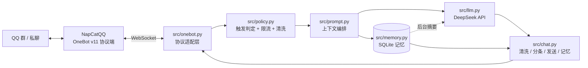

# 赛博大肥鱼 · DeepSeek QQ 群友机器人

把 DeepSeek 接进 QQ，让它在群里像个真人群友一样聊天：被叫到才接话、会看气氛、记得住刚才聊了什么、说话短、不刷屏。

这个项目是照着 B 站那类「DeepSeek 接入 QQ 群」视频的思路，**从零写的一个可读、可改的最小内核**——不是让你再装一堆插件，而是把"怎么让模型像群友"这件事拆开给你看，每一层都能自己改。

> 视频参考：[DeepSeek1017 接入 QQ 群全流程详细教学](https://www.bilibili.com/video/BV1dWnu6gEiq/)
> 本项目与视频无关联，只是实现同类效果的一种自研方案。

---

## 1. 它能做什么

| 能力 | 说明 |
| --- | --- |
| 群聊接话 | 被 `@`、被回复、或喊「大肥鱼/肥鱼」时回复；平时潜水 |
| 偶尔插话 | 按概率主动接一句（当前 5%，两次至少间隔 3 分钟，可关） |
| 群聊背景 | 记住本群最近 25 条消息，被叫到时能接上刚才的话题 |
| 会话记忆 | 每个群 / 每个私聊独立记忆，存 SQLite；老消息后台自动压成摘要 |
| 私聊 | 单独对话，可开白名单防止陌生人刷额度 |
| QQ 友好输出 | Markdown 自动洗成纯文本，长回复自动分条、引用原消息 |
| 说话像人 | 人格写在 `config/persona-whale.md`（蓝色大肥鱼·鲸鱼娘性格卡），语气、口癖、温度、边界都可调 |
| 多群人格 | 不同群可绑定不同人格文件（`persona.group_overrides`），默认人格兜底 |
| 记忆增强 | 会话笔记 + 用户画像（如"小明喜欢猫"）自动注入上下文，管理员 `/notes` 可查（Phase 3.5） |
| 上下文检查点 | 上下文水位到 80% 就做结构化检查点（长期事实 / 未完成的事 / 关键原话 / 最近话题），不再只按条数截断 |
| 原文回溯 | 摘要压缩掉的原文进归档表不丢弃，`recall_chat` 工具能翻回带日期的原话 |
| 记忆管家 | 每 6 次回复后台自动整理长期事实；区分 `[群]` 和 `[人]`，人物笔记按说话人单独注入，带日期与来源、去重（`curate_every`，0 = 关闭） |
| 待办闭环 | `add_todo` / `list_todos` / `finish_todo`：答应过的事进待办，之后的上下文和主动发言会跟进，`/todos` 可查 |
| 缓存友好 | 系统提示词前缀里不放动态时间（时间放消息末尾环境块），更容易命中模型 prefix 缓存，更省钱也更快 |
| 暧昧尺度 | 允许撒娇、抱抱、害羞、反撩等 16+（不露骨）暧昧；明确要 R18 的请求不进模型，用角色化台词化解（见 docs/08） |
| 安全边界 | 越界请求本地化解 + 按人冷却/静默 + 模型输出兜底，降低举报与封号风险（`chat.safety` 可调） |
| 自画像 | 有一整套自己的形象图（`data/self/`）；被要自拍时直接发图 + 一句台词，外观设定注入上下文，她知道自己长什么样（见 docs/09） |
| 说话人识别 | 群聊/私聊的当前消息、背景缓存、会话历史、笔记标题统一带 QQ 号，同名不同人、改昵称都能分清；还会注入本群最近说话的人（见 docs/10） |
| 防刷屏 / 防复读 | 同一人连续复读同一句时先不接（第 3 次起默认跳过），模型自己连续吐同一句也不再发（`chat.anti_spam`，见 docs/11） |
| 戳一戳回复 | 有人戳头像就回一句，台词池轮换不重样；连续戳只会更不耐烦，不升级骂人（`chat.poke`，见 docs/12） |
| 记忆治理 | 记忆管家只记跨会话的稳定信息；单群笔记到 80 条自动合并成画像，注入时画像优先（见 docs/13） |
| 心情系统 | 被夸会开心、被戳/被骂会烦，按分钟回落；心情影响语气、自画像选图和戳戳容忍度，`/mood` 可查（见 docs/13） |
| 定时提醒 | 「明天早上8点提醒我交报告」或 `/remind 明天8点 交报告`，到点主动发消息；`/reminders` 查、`/forget 3` 取消（见 docs/14、docs/20） |
| 自检 | `/doctor` 一条命令看协议端/模型/记忆/图库/预算/心情，并给自动诊断提示（见 docs/14） |
| 每日群报 | 每天固定时间把群里的梗和话题整理成 2~3 条简报，可发图片版（含活跃度/今日热词；默认关闭，见 docs/15、docs/19、docs/22） |
| 亲密度 | 每群每人互动累计，陌生鱼→熟鱼片→老鱼片→饲养员，越熟说话越随便，`/affinity` 可查（见 docs/15） |
| 主动关心 | 从群聊里发现「在考试/生病/加班/生日/低落」，过一两天主动问一句（关心语由模型按事件生成，失败回退台词池）；每人 3 天最多一次、每群每天最多 2 条、只在白天发（见 docs/23、docs/24） |
| 成绩单页面 | 打开 `/dashboard` 看今日概览/心情/亲密度排行/记忆/图库/热点词云/活跃度/预算/用量，还能取消提醒（见 docs/16、docs/21） |
| 成绩单图片 | 群里发 `/card` 或 `/成绩单`，她把数据画成一张 PNG 发出来（见 docs/17） |
| 周报 | 每周固定一天发一张本周回顾图（消息量/活跃/热词/最熟的人/本周看点，默认关闭，见 docs/25） |
| 活跃度曲线 | 成绩单图片/页面里都有「近 7 天活跃」柱状图（每天群消息条数，见 docs/18） |
| WebUI | 浏览器看状态/会话/笔记，临时静音群、清空会话、运行时调参（Phase 4.1） |
| 用量统计 | 记录每次模型调用的 token 与耗时，按天聚合；`/status` 和 WebUI 都能看（Phase 4.3） |
| 官方接口 | 可选接入 QQ 机器人开放平台（`adapters/official_qq.py`，实验性；只支持 @ 与私聊） |
| 反向 WS | 可选：机器人监听端口，NapCat 主动连过来（适合 NapCat 在内网/容器外） |
| 图片理解 | 静默理解 + 按需解释：群友发图/表情/动图时后台扫一眼写进群聊背景（只为听懂对方意思，不主动点评）；结合前后聊天推断「这张图想表达什么/什么态度」，明确问图时才详细回答 |
| 图片记忆 | 理解过的图会持久记进 SQLite（同图去重），之后聊天可以自然引用；看不懂的图反问后，群友解释会补进这条记忆 |
| 图库删除 | 群里 @她「删掉这张图」/引用图片删除 → 只标记待删，等主人确认后清理；WebUI 图库可直接删；隐私图自动拦截/清理 |
| 主动发言 | 可选：按群定时低频冒泡，带静默时段、最小间隔、每日上限，还能"没话说就 [PASS]"（Phase 3.4） |
| 防刷屏 | 冷却 + 每分钟上限 + 群白名单/黑名单 + 敏感词保险丝 |
| 回复多样性 | 记录最近 12 条回复；生成前提示别重复，生成后相似度过高会重写；固定台词轮换，避免翻来覆去同一句 |
| 碎片消息合并 | 群友一句话拆成几条短消息时，先等 `merge_window` 秒把同一人的碎片合并，再一起理解、回复，避免接半句就提问 |
| 嘴臭高压 | 仅 870 群：普通回复默认带损，被挑衅 1-3 句更直接回怼；不刷屏、不追打，认真/难过收火 |
| 固定记忆 | 置顶称呼/关系（如“鱼姐/大肥鱼/猫姐”）单独注入，不参与自动整理，不会被合并覆盖 |
| 引用上下文 | 群友引用某条消息再说话时，会把被引用的原文取回来一起理解，减少“这/那/刚才那个”指代不明 |
| 人物记忆 | 记忆管家按 `QQ号|昵称|事实` 写人物画像；当前说话人和被 @ 的人都会带上各自笔记，避免把群友混成一个人 |
| 管理命令 | `/help`、`/status`、`/notes`、`/reset`、`/重置额度`（仅管理员；主人说“重置额度”也认） |
| 联网搜索 | 关键问题自动预搜并注入来源；`/search` 走“Bing 网页结果 → 打开来源正文 → 模型总结”；梗/黑话扩展；搜不到转问群友 |
| 工具调用 | 可选开启 function calling：查时间、安全计算器、记会话笔记、记用户画像、检索笔记、回忆历史原话、待办增删查、联网搜索、读取网页正文、搜图、Penna 提示词 |
| Penna 提示词 | `/penna 描述` 把中文画面需求转成 Danbooru/SD 正向+负向提示词；所有群可用，只生成提示词，不直接出图 |
| 大肥鱼表情包 | 桌面端安装 `dsh-nekowhale-stickers`；Bot 侧同知识库，`/neko 摸鱼` 直接发图，模型可用 `sticker_search`/`sticker_send`；每次文字回复后独立 5% 概率自动穿插一张 Neko GIF |
| 工程稳定 | 断线自动重连、消息去重、发送超时、异常兜底、日志 |

---

## 2. 架构



分层职责：

```
src/
├── main.py      启动、装配、优雅退出
├── config.py    yaml + .env -> 强类型配置
├── onebot.py    OneBot v11 WebSocket：收事件、发消息、重连、去重
├── llm.py       DeepSeek HTTP 客户端：重试、超时、摘要
├── memory.py    SQLite 记忆 + 群聊背景环形缓存
├── policy.py    要不要回？是否限流？回复怎么洗、怎么分条？
├── prompt.py    人格 + 规则 + 摘要 + 历史 + 群聊背景 + 当前消息
├── tools.py     可选 function calling 工具
├── vision.py    可选图片理解（下载 → 视觉模型描述）
├── proactive.py 可选主动发言调度（静默/间隔/每日上限）
├── webui.py     可选 WebUI（FastAPI：状态/会话/静音/调参）
├── metrics.py   用量统计（token / 耗时 / 按天聚合）
├── adapters/    协议适配（official_qq.py：官方 QQ 接口）
├── admin.py     管理员命令
└── chat.py      业务编排（整条流水线）
config/
├── config.yaml  所有可调参数
├── persona-whale.md  蓝色大肥鱼·鲸鱼娘性格卡（默认人格）
├── persona-sharp.md  旧战斗形态（已停用，保留作参考）
├── personas/    每个群的独立人格文件（其他群初始性格空白，互不影响）
├── persona-friend.md 早期群友人格（留着可切换）
├── persona.md   初版人格（留着可切换）
└── persona-cat.md  多群人格示例（高冷猫）
Dockerfile / docker-compose.yml   bot + NapCat 一键启动（Phase 4.2）
```

---

## 3. 快速开始

### 3.0 前置条件

- Windows 10/11（Linux/macOS 同理），Python 3.10+
- 一个 **QQ 小号**（强烈建议，第三方协议有封号风险）
- [NapCatQQ](https://github.com/NapNeko/NapCatQQ) 已登录 QQ，并开好 OneBot v11 的 WebSocket 服务（默认 `ws://127.0.0.1:3001`）
- DeepSeek API Key：[platform.deepseek.com](https://platform.deepseek.com/)

> NapCat 的详细安装配置见 [docs/02-部署指南.md](docs/02-部署指南.md)。

### 3.1 安装依赖

```powershell
cd D:\蓝瑟大肥鱼\qq-deepseek-bot
python -m venv .venv
.\.venv\Scripts\Activate.ps1
pip install -r requirements.txt
```

### 3.2 填密钥

```powershell
Copy-Item .env.example .env
notepad .env
```

```dotenv
DEEPSEEK_API_KEY=sk-你的key
ONEBOT_ACCESS_TOKEN=你给 NapCat 设的 token（没设就留空）
```

> 图片理解不需要额外 Key：默认复用 `DEEPSEEK_API_KEY` 调 DeepSeek 视觉模型。
> 想换其他视觉服务时，再填 `VISION_API_KEY` 并改 `config.yaml` 的 `vision.base_url/model`。

### 3.3 改配置

编辑 [config/config.yaml](config/config.yaml)，最少改三处：

1. `onebot.ws_url`：NapCat 的 WS 地址；
2. `chat.admin.qq`：填你自己的 QQ，才能用管理命令；
3. `chat.private.whitelist`：建议填自己 QQ，避免陌生人私聊消耗额度。

### 3.4 启动

```powershell
python src/main.py
```

看到下面两行就成功了：

```
已连接 OneBot 服务：ws://127.0.0.1:3001
机器人账号：大肥鱼（xxxxx）
```

### 3.5 验证

- 私聊机器人「在吗」→ 应回复；
- 群里 `@机器人 在吗` → 应回复并引用你的消息；
- 群里喊「大肥鱼」→ 应回复；
- 群里随便说句话（没叫它）→ 不回复，日志显示 `跳过消息：no-trigger`；
- 管理员发 `/status` → 返回运行状态。

### 3.6 离线自测（不需要 QQ / API）

```powershell
python scripts/smoke_test.py
```

会跑 401 项检查：事件解析、触发、限流、Markdown 清洗、分条、记忆、摘要（含"摘要失败不丢消息"回归）、多群人格、工具扩展、图片理解（按需识别 + 追问最近图片）与降级、视觉客户端协议（MockTransport 不联网）、主动发言调度（静默/间隔/上限/安静守卫）、记忆增强（笔记/用户画像注入与清理）、管理员命令，上下文与记忆升级（system 前缀缓存稳定、结构化检查点提示词、原文归档 + `recall_chat`、待办闭环、记忆管家自动整理），暧昧尺度与安全边界（越界识别、本地化解、冷却/静默、输出兜底），自画像图库（发自己的照片、外观注入），说话人识别（昵称+QQ 号区分每个人），防刷屏 / 防复读（连续同一句不再回复），主人一句话重置额度（命令 + 大白话、群聊/私聊/指定群、权限与防误触），以及戳一戳自动回复（台词轮换 + 连续戳只变不耐烦）。改完代码先跑它。

还想验证 WebSocket 适配层（不连真 QQ，起一个假的 NapCat 服务端）：

```powershell
python scripts/ws_smoke_test.py
```

WebUI 测试（不连 QQ、不占端口，ASGI + 真实 uvicorn 启停都测）：

```powershell
python scripts/webui_test.py
```

用量统计测试（不联网，MockTransport 模拟 DeepSeek 返回 usage）：

```powershell
python scripts/metrics_test.py
```

官方 QQ 接口测试（不联网，MockTransport 模拟 token/REST，假 WebSocket 测握手）：

```powershell
python scripts/official_test.py
```

反向 WebSocket 测试（本地真实端口，模拟 NapCat 主动连入）：

```powershell
python scripts/reverse_ws_test.py
```

单实例锁测试（防同一 data 目录多开）：

```powershell
python scripts/instance_test.py
```

真实视觉链路测试（会调用一次配置的视觉模型 + 一次文字模型，消耗少量 token）：

```powershell
python scripts/vision_live_test.py
```

会验证静态图片、GIF 动图抽帧、表情包文字识别、图库自动描述，以及“图片描述进入聊天上下文”的端到端效果。
未配置视觉模型时会直接 SKIP。

Docker 配置静态校验（不启动容器；compose / Dockerfile / 环境变量覆盖）：

```powershell
python scripts/docker_check.py
docker compose config -q
```

### 3.7 打开 WebUI（可选）

`config.yaml`：

```yaml
web:
  enabled: true
  host: 127.0.0.1
  port: 8080
  token_env: WEB_TOKEN
```

`.env` 里 `WEB_TOKEN=` 随便设一个（**绑定非本机地址时必须设**，否则拒绝启动）。重启后浏览器打开
`http://127.0.0.1:8080/`，右上角填 token 即可看状态、会话、笔记，做临时静音/清空/调参。

> WebUI 的静音、调参只改内存，重启恢复；要永久生效请改 `config.yaml`。

### 3.8 Docker 一键启动（bot + NapCat）

本机装了 Docker Desktop 的话，可以不用手动装 NapCat：

```powershell
Copy-Item .env.example .env
notepad .env      # 填 DEEPSEEK_API_KEY / WEB_TOKEN / ONEBOT_ACCESS_TOKEN
docker compose up -d --build
```

- 打开 <http://127.0.0.1:6099> 登录 NapCat（扫码），网络配置里新建 WebSocket 服务器：`0.0.0.0:3001`，token 与 `.env` 的 `ONEBOT_ACCESS_TOKEN` 一致；
- 看机器人日志：`docker compose logs -f bot`；
- 想用 WebUI：把 `config/config.yaml` 的 `web.enabled` 改成 `true`（容器内会自动监听 `0.0.0.0`，所以必须配 `WEB_TOKEN`），重启 bot 后打开 <http://127.0.0.1:8080/>；
- 详细步骤与排错见 [部署指南 Docker 一节](docs/02-部署指南.md#63-docker-composebot--napcat)。

---

## 4. 配置速查

| 配置 | 默认 | 说明 |
| --- | --- | --- |
| `persona.name` / `file` | `蓝色大肥鱼` / `config/persona-whale.md` | 鲸鱼娘性格卡（默认人格） |
| `persona.group_overrides` | 5 个活跃群各一份 `config/personas/...` | 群号 → 人格文件；870 用“鱼姐·嘴臭高压版”，其他群用独立空白人格，互不影响 |
| `persona.group_rules` | `{100000001: ...}` | 870 专属嘴臭高压规则：普通回复默认带损，允许更密回怼，心情/好感不影响攻击性 |
| `deepseek.model` | `deepseek-chat` | 也可 `deepseek-reasoner`（更聪明、更慢更贵） |
| `deepseek.temperature` | `1.1` | 群聊人味；求稳 0.7~0.9，求活 1.2~1.3 |
| `deepseek.max_tokens` | `500` | QQ 消息短，别给太多 |
| `deepseek.enable_tools` | `false` | 开启后模型可查时间 / 算数 / 记事 / 检索笔记 |
| `vision.enabled` | `true` | 图片理解总开关（默认用 DeepSeek 视觉模型，无需另配 Key） |
| `vision.base_url` / `model` | `https://api.deepseek.com` / `deepseek-flash` | 视觉接口；换服务时改这里 + `VISION_API_KEY` |
| `vision.max_images` / `cache_size` | `2` / `50` | 每条消息最多识别几张 / 图片描述缓存条数 |
| `vision.max_image_bytes` | `32000000` | 下载硬上限；超过才放弃，正常大图会先压缩到 768px 再识别 |
| `vision.disable_thinking` | `true` | 关闭视觉模型思考，避免推理 token 占满上限、正文为空 |
| `vision.infer_expression` / `expression_max_tokens` | `true` / `80` | 结合前后聊天推断图片/表情包表达的情绪/态度 / 表达正文上限 |
| `chat.proactive.enabled` | `true` | 主动发言总开关（当前 5 个群生效，每群每天最多 3 次、间隔 180 分钟） |
| `chat.proactive.groups` | `{}` | 群号 → 频率/静默/每日上限/专属 prompt |
| `chat.proactive.interval_minutes` / `max_per_day` | `180` / `3` | 同群最小间隔 / 每天上限 |
| `chat.proactive.quiet_start` / `quiet_end` | `0` / `7` | 静默时段（默认 0~7 点不说话） |
| `web.enabled` | `false` | WebUI 开关 |
| `web.host` / `port` | `127.0.0.1` / `8080` | 监听地址 / 端口 |
| `web.token_env` | `WEB_TOKEN` | 访问令牌，建议非本机访问必须设置 |
| `metrics.enabled` | `true` | 记录 token / 耗时（独立 `data/metrics.db`） |
| `metrics.keep_days` | `30` | 启动时清理多少天前的记录 |
| `official.enabled` | `false` | 切换官方 QQ 机器人接口（需 `OFFICIAL_APP_ID/SECRET`） |
| `onebot.mode` | `forward` | `forward` 机器人连 NapCat；`reverse` NapCat 连机器人 |
| `onebot.reverse_host` / `reverse_port` | `0.0.0.0` / `3002` | 反向 WS 监听地址 / 端口 |
| `chat.group.wake_words` | `[大肥鱼, 肥鱼]` | 除了 @ 和回复之外的触发词 |
| `chat.group.ambient_chance` | `0.05` | 未被 @ 时主动插话概率（5%），0 = 完全潜水 |
| `chat.group.ambient_min_interval` | `180` | 两次插话最小间隔（秒） |
| `chat.group.cooldown` / `per_minute` | `6` / `8` | 同群冷却与每分钟上限 |
| `chat.group.history_size` | `25` | 群聊背景保留条数 |
| `chat.group.merge_window` / `merge_max_messages` | `2.5` / `5` | 短句/半句话等待合并的秒数；一次最多合并几条碎片 |
| `chat.private.whitelist` | `[]` | 空 = 所有人可私聊 |
| `chat.reply.max_chars` / `split_chars` | `350` / `400` | 总长上限 / 分条长度（大于总长 = 默认不拆条） |
| `chat.search.enabled` / `auto` / `min_chars` | `true` / `true` / `4` | 联网搜索总开关 / 关键问题自动预搜 / 太短不搜 |
| `chat.memes.chance` / `group_chances` / `group_cooldowns` | `0.25` / `{870: 0.08}` / `{870: 1800}` | 主动配图概率 / 按群单独概率 / 两次主动发图最短间隔 |
| `chat.neko.enabled` / `auto_chance` | `true` / `0.05` | NekoWhale 表情包自动穿插开关 / 每次文字回复后的独立概率 |
| `chat.memory.summary_trigger` / `summary_keep` | `20` / `8` | 多少条触发摘要 / 摘要后留几条 |
| `chat.memory.notes_limit` / `user_notes_limit` | `8` / `8` | 每次注入多少条会话笔记 / 每个人物笔记 |
| `chat.memory.pins` | `{group:100000001: [...]}` | 置顶固定记忆（称呼/关系），单独注入、不参与自动整理 |
| `chat.memory.summary_ratio` | `0.8` | 上下文水位：token 到 `token_budget × 该比例` 就提前做检查点（0 = 只按条数） |
| `chat.memory.archive_keep_days` | `30` | 摘要压缩掉的原文归档保留天数（0 = 永久；`recall_chat` 可找回） |
| `chat.memory.curate_every` | `6` | 每回复 N 次后台整理一次长期记忆（0 = 关闭） |
| `chat.memory.curate_keep` / `recall_limit` / `todos_limit` | `12` / `6` / `5` | 整理回看条数 / 单次回溯上限 / 注入待办条数 |
| `chat.memory.token_budget` | `4000` | 单次请求上下文预算（近似 token） |
| `chat.safety.enabled` / `deflect_mode` | `true` / `deflect` | 安全边界总开关 / 越界请求用俏皮化解还是直接静默 |
| `chat.safety.deflect_cooldown_minutes` | `3` | 同一群/同人两次化解的最小间隔（分钟） |
| `chat.safety.strike_limit` / `mute_minutes` | `3` / `60` | 30 分钟内越界几次后静默多久 |
| `chat.safety.flirt_enabled` / `output_guard` | `true` / `true` | 撒娇提示 / 模型输出兜底 |
| `chat.self_portrait.enabled` / `cooldown_minutes` | `true` / `3` | 自画像开关 / 同群发自拍的最小间隔（分钟） |
| `chat.anti_spam.repeat_limit` / `repeat_window` | `3` / `60` | 同一人窗口内重复同一句达到次数后不再接（0 = 关） |
| `chat.anti_spam.dedupe_replies` | `true` | 自己的回复和上一条完全相同就跳过（防复读机） |
| `chat.poke.enabled` / `window_seconds` / `angry_after` | `true` / `120` / `5` | 戳一戳自动回复 / 统计窗口 / 第几次起更不耐烦（不骂人） |
| `chat.mood.enabled` / `baseline` / `decay_per_minute` | `true` / `55` / `0.5` | 心情系统开关 / 平静能量 / 每分钟回落速度 |
| `chat.memory.distill_every` / `distilled_limit` | `80` / `8` | 单群笔记累计多少条合并成画像 / 合并后留几条 |
| `chat.remind.enabled` / `check_interval` | `true` / `30` | 定时提醒开关 / 每多少秒检查一次到期提醒 |
| `chat.daily_report.enabled` / `hour` / `minute` | `false` / `22` / `30` | 每日群报开关 / 发送时间 |
| `chat.daily_report.as_image` | `true` | 群报发图片（失败自动退回文字） |
| `chat.affinity.enabled` / `bump_per_reply` | `true` / `1` | 亲密度开关 / 每次互动加多少 |
| `chat.card.enabled` / `cooldown_minutes` | `true` / `5` | 成绩单图片开关 / 冷却期内复用同一张图 |
| `chat.care.enabled` / `per_user_days` / `per_group_daily` | `true` / `3` / `2` | 主动关心开关 / 每人几天最多一次 / 每群每天最多几条 |
| `chat.weekly_report.enabled` / `weekday` / `hour` | `false` / `6` / `21` | 周报开关 / 星期几 / 几点（默认周日 21:00） |
| `chat.group.burst_limit` / `burst_window` / `burst_pause` | `20` / `60` / `15` | 60 秒内回复超过 20 条后暂停 15 秒（0 = 关闭） |
| `chat.budget.enabled` / `daily_cny_per_group` | `true` / `0.3` | 每个群每天花费上限（元），超过当天不再调模型 |
| `chat.budget.group_limits` | `{100000001: 0.8}` | 每个群统一每天 0.8 元；870 也按 0.8 元 |
| `chat.filter.*` | 空 | 群白/黑名单、用户黑名单、敏感词 |
| `chat.admin.qq` | `[3871324658]` | 管理员/主人 QQ（能用管理命令，包括重置额度） |
| `log_level` | `INFO` | 改 `DEBUG` 可看到「跳过消息」的原因 |

---

## 5. 设计上的几个关键决定

1. **默认闭嘴。** 群里最破坏体验的不是"答得不好"，是"每条都接"。所以只有 @ / 回复 / 唤醒词 / 低概率插话才回。
2. **群聊背景和会话历史分开。** 群里其他人聊天只是"背景"，放在 user 角色里并明确告诉模型「不要逐条回应」；只有和它的对话才进会话记忆。
3. **上下文有预算。** 超预算先从最老的历史开始裁，再裁群聊背景，保证再能聊也不会越聊越贵。
4. **记忆会遗忘，但重要的不会丢。** 消息超过 20 条、或上下文水位到预算 80% 时后台压成结构化检查点，
   保留最近 8 条原文；检查点按「长期事实 / 未完成的事 / 关键原话 / 最近话题」四节写。
   被压缩掉的原文不删除，而是进 `archive` 表，模型可以用 `recall_chat` 翻回带日期的原话；
   另外每 6 次回复会有一次后台"记忆管家"把长期事实整理成带日期的笔记。SQLite 存本地，重启不丢。
5. **输出要过一遍"QQ 适配"。** 去 Markdown、去"大肥鱼："前缀、限长、按句子分条、首条引用，避免一大坨文字砸进群里。
6. **人格是文件不是代码。** 改 `config/persona-whale.md` 就能换人设，不用动 Python。
7. **上下文按「稳定 → 易变」排。** system 里只放人格和规则，时间等每轮都变的东西放到消息末尾；
   这样前缀更容易命中模型缓存，同样的聊天更便宜、首字更快（借鉴 DeepSeek‑Bot 的 prefix 稳定做法）。

更完整的推导见 [docs/01-设计思路.md](docs/01-设计思路.md)。

---

## 6. 成本与延迟

- 每条回复的输入 ≈ 人格 + 规则 + 摘要 + 最近对话 + 群聊背景 + 当前消息，按默认配置大约 1.5k~3k token，输出 ≤ 500 token。
- 日常水群一天几百条，费用通常是**几毛到几块**量级（以 DeepSeek 官网实时价格为准）。
- 想更省：调小 `history_size`、`recent_limit`、`token_budget`，或把 `ambient_chance` 设为 0。
- 图片理解分两种：
  1. **静默理解**：群友发图/表情/动图时，后台扫一眼并写进群聊背景（`[图片内容：…]`），
     只用于听懂对方发图想表达什么，不主动回复、不点评；同一张图不重复扫。
  2. **按需解释**：明确问图片内容时才详细识别并回答。
  3. **持久图片记忆**：识别过的图会按「会话 + 图源」写进 `image_memory` 表（同图去重、最多 200 条/会话），
     之后的对话会注入【最近看过的图】，可以自然引用；看不懂的图反问后，群友的解释会补进这条记忆。
  静默理解会消耗视觉 token（计入群每日预算），图片刷屏的群可以把 `vision.enabled` 设为 `false`；
  图库只收藏表情包/动图表情，并在入库时写一句短描述，`max_images` 控制每条最多几张。
  不想要视觉时把 `vision.enabled` 设为 `false`，图片会退回 `[图片]` 占位。
- 主动发言也会有额外调用：调度器只在"到点 + 群安静 + 没超每日上限"时才调一次模型；模型回 `[PASS]` 同样算一次调用（所以别把间隔调太短）。
- 延迟主要来自模型（1~4 秒）。图片理解会额外增加 1~3 秒（下载 + 视觉模型），所以建议只对"带图且被叫到"的消息启用。QQ 没有"正在输入"状态，本项目没有做占位提示；需要的话可以在 `_deliver` 前发一个表情/短句（见设计文档"扩展"）。

---

## 7. 风险与合规

- **第三方协议有封号风险。** NapCat / LLOneBot 这类方案不是官方接口，违反 QQ 用户协议，可能被限制或封号。请用不重要的**小号**，降低频率，不要群发、不要营销。
- **官方路线**：如果要做正式产品，用 [QQ 机器人开放平台](https://q.qq.com/)（合规、有审核，但需要主体资质、群聊能力要申请）。本项目的 `chat.py` / `llm.py` / `memory.py` 与协议层解耦，换成官方 SDK 的适配层即可复用。
- **内容安全**：默认提示词禁止露骨性内容/涉政/违法；越界请求由 `chat.safety` 本地化解（不进模型）+ 冷却/静默 + 输出兜底，另有 `blocked_words` 保险丝；但这只是降低风险，群里的最终责任在人，别在公开大群放开尺度。
- **隐私**：聊天记录存在本地 `data/bot.db`，不上传（除了发给 DeepSeek 的上下文）。部署在别人机器上时请提前告知群友。
- **API Key**：只放 `.env`，不要提交 git、不要发群。

---

## 8. 当前进度与后续扩展

| 阶段 | 状态 |
| --- | --- |
| Phase 1–2：骨架 + 核心聊天闭环 | ✅ 已完成（83 项离线检查 + 假 NapCat 联调） |
| Phase 3.1 多群人格 / 3.2 工具扩展 | ✅ 已完成 |
| Phase 3.3 图片理解 | ✅ 已完成（DeepSeek‑V4.1‑Flash 直接看图；GIF 抽帧 + 表情包，默认开启） |
| Phase 3.4 主动能力 | ✅ 已完成（默认关闭，按群配置） |
| Phase 3.5 记忆增强 | ✅ 已完成（笔记 + 用户画像注入） |
| Phase 4.1 WebUI | ✅ 已完成（状态 / 会话 / 静音 / 运行时调参） |
| Phase 4.2 Docker | ✅ 已完成（bot + NapCat 一键 compose） |
| Phase 4.3 用量统计 | ✅ 已完成（token/耗时、日报、`/status`、WebUI 用量卡片） |
| Phase 4.4 官方接口 | ✅ 已完成（实验性：群 @ / 私聊，openid 映射，REST 发送） |
| Phase 4.5 反向 WS | ✅ 已完成（NapCat 主动连入 + token 鉴权 + 本地联调测试） |
| Phase 4.5 单实例保护 | ✅ 已完成（文件锁防多开；崩溃自动释放） |
| Phase 4.6 记忆与上下文升级 | ✅ 已完成（结构化检查点 + 原文归档 `recall_chat` + 记忆管家 + 待办闭环 + 缓存友好前缀，见 docs/07） |
| Phase 4.5 多实例（Redis/Postgres） | ⏳ 可选扩展（需外部服务，未实现） |

> 最终验收：见 [docs/05-验收报告.md](docs/05-验收报告.md)。单机范围 Phase 1–4 已交付；多实例横向扩展按可选事项保留。

| 方向 | 做法 |
| --- | --- |
| 语音 | 接 TTS（如 edge-tts）发 `record` 段；或接 ASR 处理语音消息 |
| 联网搜索 | 已完成：Bing RSS 搜索 + 关键问题自动预搜；结果作为资料注入，模型尽量附来源；失败会明说查不到 |
| 表情包 | 已实现：收集群友表情/GIF、视觉描述、按语境匹配发送（见 docs/06） |
| 视觉检索 | 图库目前按关键词匹配描述；可升级成向量检索或图片相似度 |
| 群管理 | 欢迎新人、关键词提醒、定时播报 |
| 多模型路由 | 闲聊用小模型、正经问题用 reasoner，`llm.py` 加路由 |
| WebUI | 已实现（Phase 4.1）；可继续加：人格编辑、配置写回 YAML、Token 用量图表 |
| NoneBot2 化 | 把 `ChatService.handle` 包成 NoneBot 插件，享受插件生态 |

---

## 9. 文档

- [docs/00-框架结构设计.md](docs/00-框架结构设计.md)：**评审稿**——模块骨架、接口契约、分阶段填充计划、待确认决策
- [docs/01-设计思路.md](docs/01-设计思路.md)：整体思路、触发策略、上下文工程、记忆、成本、风控
- [docs/02-部署指南.md](docs/02-部署指南.md)：NapCat 安装、配置、启动、后台运行、排错
- [docs/03-人格调教.md](docs/03-人格调教.md)：怎么让模型说话像群友，常见"病症"与处方
- [docs/04-从视频到本项目.md](docs/04-从视频到本项目.md)：视频里的常见做法 vs 本项目的取舍，以及怎么一步步改成你自己的
- [docs/05-验收报告.md](docs/05-验收报告.md)：Phase 1–4 交付清单、测试证据、已知限制与后续建议
- [docs/06-图库与视觉配置.md](docs/06-图库与视觉配置.md)：图片 / GIF / 表情包识别、图库与视觉模型配置
- [docs/07-记忆与上下文升级.md](docs/07-记忆与上下文升级.md)：借鉴 DeepSeek‑Bot 的记忆管家、上下文检查点、原文回溯与待办闭环
- [docs/08-暧昧尺度与安全边界.md](docs/08-暧昧尺度与安全边界.md)：16+（不露骨）暧昧尺度、越界请求本地化解、冷却/静默与输出兜底
- [docs/09-自画像图库.md](docs/09-自画像图库.md)：程序化自画像、视觉模型看自己、发图触发词与外观注入
- [docs/10-说话人识别.md](docs/10-说话人识别.md)：昵称+QQ 号标记说话人、花名册注入、同名/改昵称处理
- [docs/11-防刷屏与防复读.md](docs/11-防刷屏与防复读.md)：连续复读同一句不接、自己回复重复不发、可调参数
- [docs/12-戳一戳自动回复.md](docs/12-戳一戳自动回复.md)：戳头像自动回、台词轮换、连续戳只变不耐烦
- [docs/13-记忆治理与心情系统.md](docs/13-记忆治理与心情系统.md)：笔记合并成画像、心情状态机、大图识别修复
- [docs/14-定时提醒与自检.md](docs/14-定时提醒与自检.md)：自然语言定时提醒、后台调度、`/doctor` 自检
- [docs/15-每日群报与亲密度.md](docs/15-每日群报与亲密度.md)：每日群报、亲密度等级、语音方案尝试记录
- [docs/16-成绩单页面与热点词.md](docs/16-成绩单页面与热点词.md)：WebUI 成绩单页、热点词云、`/report` 手动群报
- [docs/17-成绩单图片.md](docs/17-成绩单图片.md)：`/card` 把成绩单画成图片、缓存与词云过滤
- [docs/18-活跃度曲线.md](docs/18-活跃度曲线.md)：近 7 天活跃数据、成绩单图片与页面里的柱状图
- [docs/19-群报图片.md](docs/19-群报图片.md)：群报图片版（标题 + 看点 + 数据脚注，失败退回文字）
- [docs/20-取消提醒与群报活跃图.md](docs/20-取消提醒与群报活跃图.md)：`/forget` 取消提醒、群报图片加活跃小图、`/help` 两段式
- [docs/21-WebUI提醒管理.md](docs/21-WebUI提醒管理.md)：网页端列提醒、一键取消（`/api/reminders`）
- [docs/22-手动群报与群报热词.md](docs/22-手动群报与群报热词.md)：WebUI 一键发群报（`/api/report`）、群报图片加今日热词
- [docs/23-主动关心.md](docs/23-主动关心.md)：规则识别考试/生病/加班/生日/低落，到期主动问一句（带防打扰）
- [docs/24-关心语润色与群报关心小注.md](docs/24-关心语润色与群报关心小注.md)：关心语模型生成 + 群报图片「最近在关心」
- [docs/25-周报.md](docs/25-周报.md)：每周回顾图（消息量/活跃/热词/最熟的人/本周看点）

## 表情包收集与发送

最新行为及视觉模型配置见 [图库与视觉配置](docs/06-图库与视觉配置.md)。
当前已启用表情包收藏和本机图库，非 @ 回复概率为 15%；配图按语境匹配，
20% 概率尝试发送，没匹配到也会随机发一张本群表情（图库为空时才只发文字）。
以下早期说明中的随机发图策略已被语境匹配替代。

NapCat / OneBot 模式默认启用 `chat.memes`：从允许参与的群聊中后台收集
QQ 标记为表情包的图片（`image.sub_type=1`、`7`）、`mface` 商城表情，
以及 `collect_all_images: true` 时才收普通图片。默认 `false`：**普通照片不入库**，
只把表情/动图表情收进图库。
收藏时自动写一句短描述；同一张图只入库一次（内容哈希 + QQ 文件名去重），
之后需要配图时直接从图库调用，不会反复收藏或逐张讲解。
配图优先按语境匹配；没匹配到则随机发一张，不会再有图却发不出去。
群友明确说“发个表情 / 来张图 / 会发图吗 / 有没有表情包”时，会**强制真的发一张**
（不受 20% 概率影响）；模型文字里假装的“（发送 xx 图片）”会被清掉，不会再出现
“说有图、实际没图”的情况。
普通照片默认不收藏；确实想连照片一起收时把 `collect_all_images` 改成 `true`。

每次成功发送普通群聊文字回复后，按群配置概率从本群图库随机附带一张表情包（870 群为 0.03 且 30 分钟冷却），尽量避免连续重复。图库为空时只发文字；管理命令、私聊和
定时主动发言不附图。20% 是每次独立抽取的概率，并非每十条必发两张。

图片按群保存在 `data/memes/<群号>/`，内容去重，重启保留；每群最多 200 张、
单张最多 5MB，满后停止收集。也可手动放入 PNG/JPG/GIF/WebP 图片。

## 删除图库图片

- 群里 **@她并回复那张图** 说「删掉这张 / 删除这张表情包」→ **只标记待删除**，等主人确认后再清理；
- 不引用图时，@她说「删掉刚才那个表情包」→ 标记本群最近一次发出去的表情包；
- 主人可运行 `python scripts/meme_admin.py pending` 查看、`purge` 确认删除；
- WebUI 图库每张图下方也有「删除」按钮，调用 `DELETE /api/gallery/<群号>/<文件名>`；
- 只删图库收藏，不撤回 QQ 里的历史消息；找不到会明确说“图库里没找到”，不会假装删除成功。
- 删除不需要管理员权限，群友都能删本群的图；删除操作会写日志（谁、哪个群、删了什么）。
黑名单群、静音群、黑名单用户及被过滤的消息不参与自动收集。
收集失败或发图失败不会阻断文字聊天。仅下载 QQ 图片 CDN，不跟随重定向。
官方 QQ 适配器暂不支持这项功能。

随机接话概率已由 0.015 调整为 0.012（相对降低 20%）；@、回复机器人、
唤醒词和私聊沿用原有触发规则。以上配置修改后需要重启生效。

验证命令：`python scripts/memes_test.py`。

## 回复频率与花费保护

- **回话频率**：非 @ 消息独立抽 15% 回复；@、回复她、喊唤醒词仍必触发。
- **突发限流**：同一个群 60 秒内回复超过 20 条（含 @），就会暂停回复，
  至少 15 秒内不再回（`chat.group.burst_limit / burst_window / burst_pause`）。
  暂停期间消息仍进群聊背景，不会丢上下文。
- **每群每天花费上限 0.3 元**（`chat.budget`）：每次聊天/摘要/图片识别的 usage
  按 DeepSeek `deepseek-flash` 官方 token 价格估算（高峰时段自动翻倍），
  按「群号 + 本地日期」写进 `data/budget.db`；超过额度后当天不再调用模型，
  @ 她会收到一次“今天额度用完”的提示，第二天自动恢复。
- **按群单独额度**：`chat.budget.group_limits` 可以给某个群更高/更低的上限，
  现在每个群统一每天 0.8 元；
  没列出的群自动用 `daily_cny_per_group`。
- **重置今天的额度**：主人在群里直接说「重置额度」（或 `/重置额度`）就重置**本群**；
  私聊说「重置额度」默认重置**全部群**；带群号（`/重置额度 100000001`）或「全部」可指定范围。
  命令在 Bot 进程内直接清 `BudgetStore`，**立刻生效，不用重启、不用改后台/数据库**：

  ```text
  主人：/重置额度            → 重置当前群今天的额度
  主人：把今天的额度重置一下  → 同上（大白话也认）
  主人私聊：重置额度          → 重置今天全部群
  ```

  机器人没在跑（或只想清库）时，仍可用脚本兜底：

  ```powershell
  python scripts/reset_budget.py 100000001
  ```
- 单价、汇率和上限都在 `config/config.yaml` 的 `chat.budget` 里可调；
  不想限制就把 `chat.budget.enabled` 设为 `false`。
- WebUI `/api/status` 的 `reply_burst` 和 `budget.today` 能看到当前状态和今天各群花费。

## 智能群友模式

当前默认使用 `config/persona-whale.md`（蓝色大肥鱼·鲸鱼娘性格卡：傲娇嘴甜、温柔心软、爱吃白饭、拒绝被叫胖）；
群 **100000001** 用 `config/personas/group-100000001.md`（鱼姐·嘴臭高压版：普通回复默认带损，被挑衅 1-3 句更直接回怼；不刷屏、不追打，对方认真/难过收火；心情/好感不影响攻击性）。
其他活跃群（100000002 / 100000003 / 100000004 / 100000005）各绑定 `config/personas/group-<群号>.md`：
**初始性格空白、不含攻击系和攻击词汇**，只保留主人/看图/16+/安全/记忆等后续设定；
每个群文件互相独立，之后可以分别长成不同的群性格。旧 `persona-sharp.md` 保留作参考，不再启用。
早期人格文件保留可切换。启用工具后，
关键问题会自动通过 Bing RSS 预搜（`chat.search`），也可以由 `web_search` 工具主动搜；结果会作为资料注入，模型尽量附来源。
搜索不可用时明确说明；搜索摘要不等于核验过全文。

可直接说“以后少反问”“温柔一点”“认真问题讲详细点”。模型识别到明确
反馈后会调用 `cultivate_personality` 写入本会话长期笔记，重启保留；
最新笔记随上下文注入，不同群分别培养，`/reset` 会清除本会话培养记录。
这是基于记忆的风格调整，不是训练模型权重。

`always_reply_at: true` 时，@ 消息不受冷却和分钟上限限制；其他群消息
（包括唤醒词及引用回复）独立抽取 15% 概率。静音、黑名单和禁用规则仍生效，
机器人自己的消息跳过。网络故障时 @ 消息尝试发送失败提示，无法保证断线期间送达。
同一群串行处理，繁忙时可能排队。表情包仍为文字回复后的 20% 概率附图。

修改后关闭旧智能体窗口，再运行 `start_bot.bat`；NapCat 可继续保持运行。
如果旧机器人在后台没关干净，双击根目录的 `restart_bot.bat` 会自动停掉占用 8080 端口的旧进程再启动。
回归检查：`python scripts/friend_test.py`。

## 10. 参考

- [NapCatQQ](https://github.com/NapNeko/NapCatQQ) · [OneBot v11 标准](https://github.com/botuniverse/onebot-11)
- [DeepSeek API 文档](https://api-docs.deepseek.com/zh-cn/)
- 原视频：[DeepSeek1017 接入 QQ 群全流程详细教学](https://www.bilibili.com/video/BV1dWnu6gEiq/)
- [docs/30-云服务器部署实录.md](docs/30-云服务器部署实录.md)：NapCat Docker + bot + Gitee 自动同步的完整部署实录与踩坑清单

## 📦 公开版本说明

本仓库是脱敏后的公开版本：机器人 QQ 号、服务器 IP、真实群号、群专属人格规则都已替换为示例值，
`config/personas/group-*.md` 只保留一份示例。真实部署时请按 `docs/28`/`docs/30` 填自己的配置。
