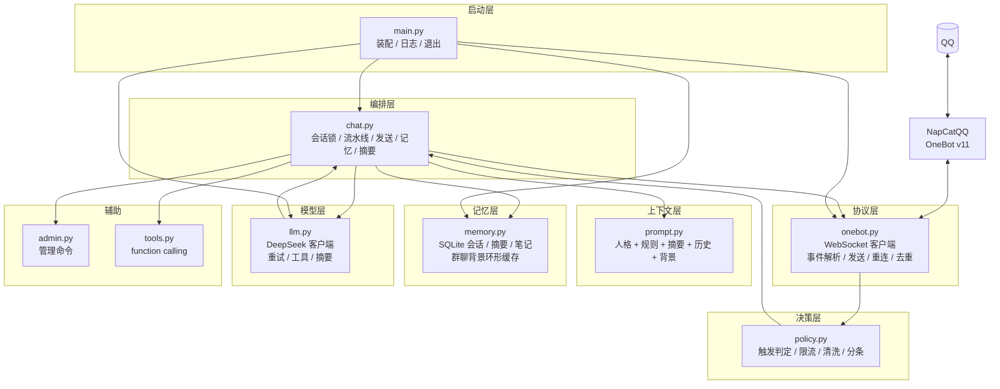
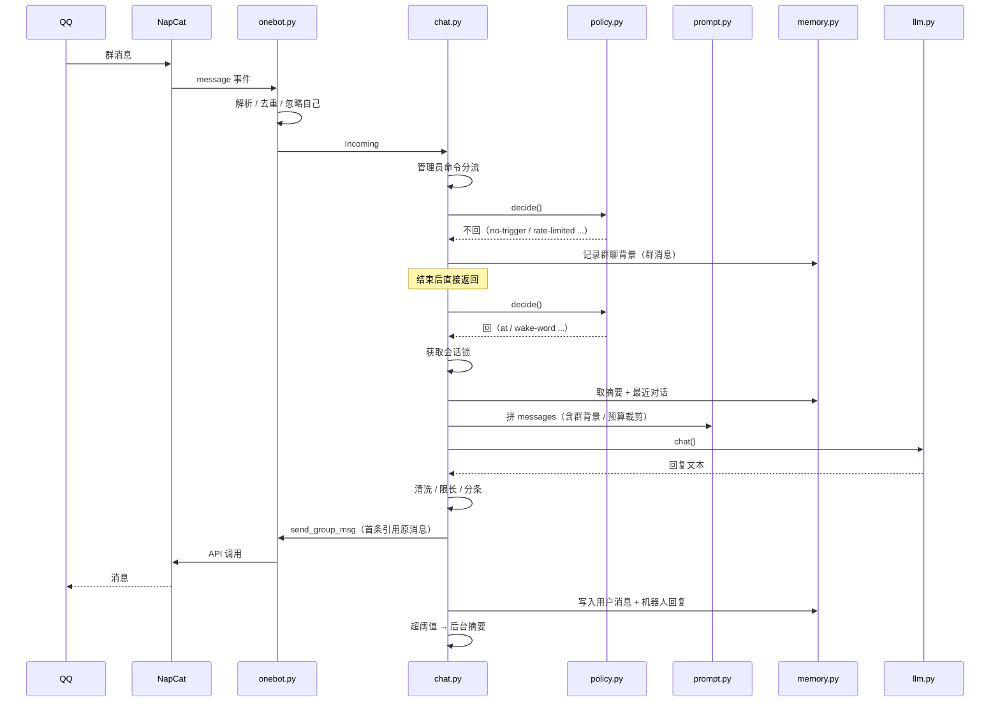

# 框架结构设计（评审稿）

> **状态：已确认，按 Phase 3 → Phase 4 顺序填充中。**
> 第一轮（2026-10-20）：Phase 3.1 多群人格、Phase 3.2 工具扩展，并修复 13.1 的 P0（摘要失败丢消息）。
> 第二轮（2026-10-20）：Phase 3.3 图片理解（vision.py + 降级 + MockTransport 协议测试）。
> 第三轮（2026-10-20）：Phase 3.4 主动能力（proactive.py 调度器，静默/间隔/每日上限 + 安静守卫）。
> 第四轮（2026-10-20）：Phase 3.5 记忆增强（会话笔记 + 用户画像注入、save_user_note、/notes）。
> 第五轮（2026-10-20）：Phase 4.1 WebUI（FastAPI 状态/会话/静音/运行时调参 + token 鉴权）。
> 第六轮（2026-10-20）：Phase 4.2 Docker（Dockerfile + compose：bot + NapCat，配置环境变量覆盖）。
> 第七轮（2026-10-20）：Phase 4.3 用量统计（metrics.py：token/耗时、按天聚合、`/status`、WebUI）。
> 第八轮（2026-10-20）：Phase 4.4 官方接口适配（adapters/official_qq.py：openid 映射、网关、REST 发送）。
> 第九轮（2026-10-20）：Phase 4.5 反向 WS（NapCat 主动连入、token 鉴权、6 项本地联调测试）+ 单实例锁（文件锁防多开，4 项测试）。
> 第十轮（2026-10-20）：最终验收（全量 180 项离线检查通过），见 `docs/05-验收报告.md`。
>
> 说明：Phase 1–4 的单机范围已交付；用户确认的「完整填充」在本轮收尾。多实例横向扩展（Redis/Postgres）标记为可选扩展，不在本次交付范围。

---

## 1. 目标与非目标

### 目标

1. QQ 群聊 / 私聊里提供「像群友」的对话体验：默认沉默、被叫才答、说话短、记得住。
2. 每层可单独替换：协议端、模型、存储、人格，换一个不影响其他层。
3. 行为可配置：触发方式、频率、长度、记忆深度、敏感词、群/用户黑白名单。
4. 可控成本与稳定运行：上下文有预算，断线能重连，单条消息异常不拖垮进程。
5. 代码可读：一个模块一个职责，单文件控制在 350 行内，方便二次开发。

### 非目标

- 不做通用 Agent 平台 / 多租户 SaaS；
- 不追求「每条都回」，回复率不是 KPI；
- 不内置内容审核系统（只留保险丝）；
- 不在本框架内解决 QQ 协议合规问题（第三方协议端的风险由部署者承担，可另接官方接口）。

---

## 2. 架构总览



### 依赖方向规则（重要）

| 规则 | 原因 |
| --- | --- |
| 协议层不 import 编排层 | 换协议端时不动业务 |
| `policy.py` 不 import 模型 | 纯函数，可脱离网络单测 |
| `prompt.py` 不读数据库 | 只接收已取好的数据，便于测试 |
| `chat.py` 只依赖 `LLMLike` / `SenderLike` 协议 | 测试可注入替身，不连真 QQ / API |
| 配置只从 `config.py` 进入，模块内不读 YAML / env | 一处校验，避免散落 |

---

## 3. 模块骨架

```
qq-deepseek-bot/
├── src/
│   ├── main.py       入口：加载 .env → 配置 → 人格 → 装配 → run
│   ├── config.py     配置模型（dataclass）+ .env 加载 + YAML 解析
│   ├── onebot.py     OneBot v11 协议适配（唯一认识 QQ 协议的文件）
│   ├── llm.py        DeepSeek HTTP 客户端（唯一认识模型 API 的文件）
│   ├── memory.py     持久化与缓存（唯一认识 SQLite 的文件）
│   ├── policy.py     决策与输出整形（纯函数优先）
│   ├── prompt.py     上下文拼装与预算裁剪
│   ├── tools.py      可选工具：时间 / 计算器 / 记事 / 检索笔记
│   ├── vision.py     可选图片理解（下载 → 视觉模型 → 描述，失败降级）
│   ├── proactive.py  可选主动发言调度（静默时段 / 间隔 / 每日上限）
│   ├── webui.py      可选 WebUI（FastAPI：状态 / 会话 / 静音 / 调参）
│   ├── metrics.py    用量统计（token / 耗时 / 按天聚合）
│   ├── adapters/     协议适配（official_qq.py：官方 QQ 接口）
│   ├── admin.py      管理员命令：/help /status /reset
│   └── chat.py       编排：把以上模块串成一条消息流水线
├── config/
│   ├── config.yaml   全部可调参数
│   ├── persona.md    默认人格（system prompt 主体）
│   └── persona-cat.md 多群人格示例
├── scripts/
│   ├── smoke_test.py     离线链路测试（83 项）
│   ├── webui_test.py     WebUI 测试（21 项，ASGI + 真实 uvicorn）
│   ├── docker_check.py   Docker 配置校验（22 项，不启动容器）
│   ├── metrics_test.py   用量统计测试（22 项，MockTransport 不联网）
│   ├── official_test.py  官方接口测试（22 项，假网关/假 REST）
│   ├── reverse_ws_test.py 反向 WS 测试（6 项，本地真实端口）
│   ├── instance_test.py   单实例锁测试（4 项）
│   └── ws_smoke_test.py  假 NapCat 的 WebSocket 联调
├── docs/             设计 / 部署 / 人格 / 视频对照
├── data/             SQLite（运行时生成）
├── Dockerfile / docker-compose.yml   bot + NapCat 一键启动
├── .env.example
├── requirements.txt
└── start.bat
```

### 各模块职责与对外接口

| 模块 | 职责 | 对外接口 | 不应做的事 |
| --- | --- | --- | --- |
| `config.py` | 配置解析与默认值 | `Settings.from_dict` / `load_settings` / `load_dotenv` | 不发网络、不建 DB |
| `onebot.py` | 连接、解析、发送 | `OneBotClient.run/close/send_group_text/send_private_text`、`parse_incoming` | 不决定该不该回 |
| `policy.py` | 触发、限流、清洗 | `decide` / `RateLimiter` / `AmbientGate` / `clean_reply` / `split_text` | 不调模型、不读 DB |
| `prompt.py` | 上下文拼装 | `build_system` / `compose_messages` / `estimate_tokens` | 不读 DB、不裁剪业务 |
| `memory.py` | 记忆读写 | `MemoryStore.*` / `GroupHistory.*` | 不调模型（摘要由编排层发起） |
| `llm.py` | 模型调用 | `complete` / `chat` / `summarize` / `aclose` | 不拼人格、不写 DB |
| `vision.py` | 图片转文字描述（可选） | `VisionClient.describe` / `aclose` | 不拼上下文、不写 DB、失败必须降级 |
| `proactive.py` | 主动发言调度（可选） | `ProactiveScheduler.start/stop/tick_once` | 不生成内容、不直接发消息 |
| `webui.py` | WebUI（可选） | `create_app` / `start_webui` | 不直接改模型状态、不写回 YAML |
| `metrics.py` | 用量统计（可选） | `MetricsStore.record/today_summary/daily` | 不参与聊天决策、不影响主流程 |
| `adapters/official_qq.py` | 官方 QQ 接口适配（可选） | `OfficialQQClient.run/close/send_*`、`to_incoming` | 不决定回不回、不拼上下文 |
| `chat.py` | 流水线与生命周期 | `handle` / `shutdown` | 不碰 WebSocket 原始帧 |
| `admin.py` | 管理命令 | `handle_command` | 不直接发消息 |
| `tools.py` | 工具定义与分发 | `TOOL_SPECS` / `dispatch` | 不决定何时调用 |

---

## 4. 关键接口契约

### 4.1 进来的消息

```python
@dataclass(slots=True)
class Incoming:
    kind: str                 # "group" | "private"
    session_id: str           # "group:123456" | "private:10001"
    user_id: int
    message_id: str
    nickname: str
    text: str                 # 已把消息段拍平成文本（图片→[图片]）
    at_self: bool = False
    reply_to: str | None = None
    group_id: int | None = None
    is_self: bool = False
    raw: dict = field(default_factory=dict)
```

约定：`Incoming` 是协议层与业务层的唯一数据契约。新增协议端只需产出它。

### 4.2 要不要回

```python
@dataclass(slots=True)
class Decision:
    reply: bool
    reason: str   # at | reply-to-bot | wake-word | ambient | private | rate-limited | ...
```

`reason` 必须可用于日志，调参时靠它判断"为什么没回/为什么回了"。

### 4.3 发送端

```python
class SenderLike(Protocol):
    async def send_group_text(self, group_id: int, text: str,
                              reply_to: str | None = None) -> str | None: ...
    async def send_private_text(self, user_id: int, text: str,
                                reply_to: str | None = None) -> str | None: ...
```

返回 `message_id` 用于两件事：引用回复的识别、机器人自身消息跟踪。

### 4.4 模型端

```python
class LLMLike(Protocol):
    async def chat(self, messages, **kwargs) -> str: ...
    async def complete(self, messages, **kwargs) -> dict: ...
    async def summarize(self, old_summary: str, transcript: str) -> str: ...
```

`complete` 返回原始 assistant message（支持 tool_calls）；`chat` 返回纯文本。

### 4.5 记忆端

```python
add_message(session_id, role, name, content)
recent_messages(session_id, limit) -> list[dict]
count_messages(session_id) -> int
peek_oldest(session_id, keep) -> list[dict]   # 只读取最老的一批，不删除
delete_messages(ids)                          # 摘要成功后再删除
get_summary / set_summary
add_note / recent_notes / search_notes
add_user_note / recent_user_notes
reset_session(session_id)   # 清消息、摘要、会话笔记；用户画像保留
```

### 4.6 编排端

```python
class ChatService:
    async def handle(self, incoming: Incoming) -> None: ...
    async def shutdown(self) -> None: ...
```

`handle` 内部保证：同一 `session_id` 串行、单条异常不抛出、发送成功后才写记忆。

### 4.7 视觉端（可选）

```python
class VisionLike(Protocol):
    async def describe(self, urls: list[str]) -> str: ...
```

约定：`describe` 永远不抛异常给编排层（内部吞掉并记日志），未配置/失败返回空串，
`chat.py` 据此决定是否把「[图片内容：…]」拼进当前消息。

### 4.8 主动发言调度

```python
class ProactiveSpeaker(Protocol):
    async def speak_proactively(self, group_id: int) -> bool: ...

class ProactiveScheduler:
    def start(self) -> None: ...
    async def stop(self) -> None: ...
    async def tick_once(self, now: float | None = None) -> list[int]: ...
```

约定：调度器只负责"什么时候该说"（静默时段、间隔、每日上限）；说不说、说什么、是否 `[PASS]`
由 `ChatService.speak_proactively` 决定。`tick_once(now)` 可注入时间，便于测试。

---

## 5. 一次消息的时序



### 异常分支约定

| 场景 | 行为 | 是否写记忆 |
| --- | --- | --- |
| 模型超时 / 报错 | 记日志、计数、不回复 | 否 |
| 模型返回空 | 记日志、不回复 | 否 |
| 发送失败 | 记日志、继续下一条分片 | 否（当前实现存在"部分分片发出"的边界，Phase 3 改为整体成功才写） |
| 摘要失败 | 记日志；**当前实现会丢已摘出的消息**（见 13.1） | — |
| 单条消息处理异常 | 由 `_safe_handle` 捕获，进程继续 | — |
| 协议端断开 | 退避重连，pending 调用置错 | — |

---

## 6. 数据模型

会话 ID 约定：`group:<群号>` / `private:<QQ号>`，天然隔离不同群和私聊。

```sql
messages   (id, session_id, role, name, content, ts)
summaries  (session_id PK, content, updated_at)
notes      (id, session_id, content, created_at)
user_notes (id, user_id, content, created_at)
```

- 索引：`messages(session_id, id)`、`notes(session_id, id)`。
- 写入时机：发送成功后成对写入 `user` + `assistant`；被跳过/失败的对话不进会话记忆。
- 泄漏控制：摘要压缩 + `peek_oldest` / `delete_messages` 保留近 N 条；预留 `purge_older_than(hours)`。
- 群聊背景（未触发消息）只进内存环形队列，不落盘。

---

## 7. 配置结构

```yaml
deepseek:      # api_key_env, base_url, model, temperature, max_tokens,
               # timeout, max_retries, enable_tools
onebot:        # mode(forward/reverse), ws_url, reverse_host, reverse_port,
               # access_token_env, reconnect_interval, request_timeout
official:      # enabled, app_id, app_secret, intents, api_base, gateway_url
vision:        # enabled, base_url, model, api_key_env, timeout, max_images,
               # max_image_bytes, cache_size, prompt
web:           # enabled, host, port, token_env
metrics:       # enabled, db_path, keep_days
persona:       # name, file, group_overrides
chat:
  group:       # enabled, wake_words, ambient_chance, ambient_min_interval,
               # cooldown, per_minute, history_size
  private:     # enabled, cooldown, per_minute, whitelist
  reply:       # max_chars, split_chars, quote, chunk_delay
  memory:      # db_path, recent_limit, summary_trigger, summary_keep,
               # token_budget, notes_limit
  filter:      # whitelist_groups, blacklist_groups, blacklist_users, blocked_words
  admin:       # qq
  proactive:   # enabled, check_interval, interval_minutes, quiet_start, quiet_end,
               # max_per_day, min_silence_minutes, groups
log_level:
```

加载优先级：真实环境变量 > `.env` > YAML 明文 > 代码默认值。密钥只放 `.env`。

---

## 8. 目标态目录（含待填充）

```
src/
├── ...（现有模块）
└── adapters/             # 已实现：official_qq.py（官方 QQ 接口）
tests/                    # 现有 scripts 迁移为 pytest（可选）
```

---

## 9. 分阶段填充计划

| 阶段 | 内容 | 状态 | 验收 |
| --- | --- | --- | --- |
| Phase 1 骨架 | 配置 / 协议 / 决策 / 上下文 / 记忆 / 模型 / 编排的模块与接口 | ✅ 已实现 | 模块可 import，配置可加载，目录结构成型 |
| Phase 2 核心闭环 | 触发、限流、上下文、记忆、清洗、分条、命令、摘要、重连 | ✅ 已实现 | 83 项离线检查 + 假 NapCat WebSocket 联调通过 |
| Phase 3 智能能力 | 多群人格、工具扩展、图片理解、主动能力、记忆增强 | ✅ 已完成（3.1–3.5） | 每项有独立验收；不破坏 Phase 2 测试 |
| Phase 4 工程化 | WebUI、Docker、监控/成本、官方接口适配、反向 WS/多实例 | ✅ 单机范围已交付（4.1–4.5）；多实例横向扩展为可选 | 可一键启动、可观测、可迁移官方接口；见 05 验收报告 |

### Phase 3 细化

| 编号 | 子项 | 设计要点 | 主要改动文件 | 状态 / 验收 |
| --- | --- | --- | --- | --- |
| 3.1 | 多群人格 | 配置 `persona.group_overrides: {群号: 文件}`，`ChatService` 按群选 persona | `config.py` / `chat.py` / `main.py` | ✅ 已完成：A 群与 B 群人设不同 |
| 3.2 | 工具扩展 | 时间、安全计算器、记事、检索笔记；工具调用闭环 | `tools.py` / `memory.py` / `chat.py` | ✅ 已完成：工具结果回传模型；联网搜索留扩展点 |
| 3.3 | 图片理解 | 下载图片（大小/类型/数量限制）→ OpenAI 兼容视觉模型 → 注入上下文；失败降级为 `[图片]` | `vision.py` / `onebot.py` / `chat.py` / `main.py` | ✅ 已完成：发图问"这是什么"能答；失败/未配置不影响聊天 |
| 3.4 | 主动能力 | 按群定时冒泡；静默时段、最小间隔、每日上限、群安静守卫；模型可回 `[PASS]` | `proactive.py` / `chat.py` / `config.py` / `main.py` | ✅ 已完成：默认关闭，按群配置；不打断正在聊天的群 |
| 3.5 | 记忆增强 | 会话笔记 + 用户画像（`user_notes`）自动注入；`save_user_note` 工具；`/notes` 查看；`/reset` 清会话笔记但保留画像 | `memory.py` / `prompt.py` / `chat.py` / `tools.py` / `admin.py` | ✅ 已完成：回答能带上"你记得的事"；笔记可控可查 |

### Phase 4 细化

| 编号 | 子项 | 设计要点 | 状态 / 验收 |
| --- | --- | --- | --- |
| 4.1 | WebUI | FastAPI + 原生页面：状态、会话消息/摘要/笔记、临时静音、清空会话、运行时调参；token 鉴权，默认只绑定本机 | ✅ 已完成：浏览器可操作；`webui_test.py` 21 项（ASGI + 真实 uvicorn） |
| 4.2 | Docker | `docker-compose` 同时起 bot 与 NapCat（共享 data 卷与 env） | ✅ 已完成：`docker compose up -d --build`；环境变量覆盖（`ONEBOT_WS_URL` / `WEB_HOST` / `WEB_PORT`）；22 项静态校验 |
| 4.3 | 监控/成本 | 记录 token 用量与耗时，按天聚合；`/status` 和 WebUI 展示；启动时清理旧记录 | ✅ 已完成：`metrics.db` 独立存储；22 项测试（含 MockTransport usage 回调） |
| 4.4 | 官方接口适配 | `adapters/official_qq.py` 实现 `SenderLike` 并把官方事件转 `Incoming`；openid ↔ int 稳定映射；token 缓存与心跳 | ✅ 已完成：`official.enabled` 切换，不改 `chat.py`；22 项测试 |
| 4.5 | 反向 WS / 多实例 | 反向 WS：`serve` 监听 + token 鉴权 + `X-Self-ID`；单实例文件锁；多实例：Redis 锁/限流、Postgres 记忆 | 反向 WS ✅（6 项）+ 单实例锁 ✅（4 项）；Redis/Postgres ⏳ 可选扩展 |

---

## 10. 技术选型

| 决策 | 推荐（当前） | 备选 | 影响 |
| --- | --- | --- | --- |
| 协议端 | NapCatQQ + 正向 WS | LLOneBot；官方 QQ 机器人 | 第三方有封号风险；官方需资质 |
| 模型 | `deepseek-chat` | `deepseek-reasoner`（正经问题）；多模态模型（图片） | 成本 / 延迟 / 能力 |
| 存储 | SQLite + WAL | Postgres / Redis | 多实例需换 |
| 异步 | asyncio + httpx + websockets | NoneBot2 框架 | 自研可控，框架省事 |
| 部署 | venv + 计划任务 / systemd | Docker Compose | Docker 更适合服务器 |
| WebUI | FastAPI + 原生页面 | Vue/React | 够用优先 |

---

## 11. 需要你确认的决策点

> 2026-10-20 已确认：选择「按 Phase 3 → Phase 4 顺序完整填充」。以下保留作变更记录。

| # | 决策 | 推荐 | 备选 | 说明 |
| --- | --- | --- | --- | --- |
| 1 | 是否按本设计继续填充 | 是 | 先调整设计 | 调整请指出模块 / 阶段 / 接口 |
| 2 | 填充优先级 | Phase 3 → Phase 4 顺序做 | 只做 Phase 3；只做工程化 | Phase 3 更影响"像不像人" |
| 3 | 图片理解方案 | ✅ 已实现：接 OpenAI 兼容视觉模型（需自备 Key） | 本地 OCR / 只占位 | 取决于你有哪些 API |
| 4 | 部署环境 | 本机 Windows | 云服务器 Linux / Docker | 影响后台运行与 NapCat 部署方式 |
| 5 | 人格 | 保留「大肥鱼」 | 换成你的角色 / 多群多角色 | 改 persona 即可 |
| 6 | 合规 | 小号 + 第三方协议 | 迁移官方 QQ 机器人 | 长期做产品建议官方 |

---

## 12. 扩展点索引

| 想改什么 | 改哪里 |
| --- | --- |
| 触发规则 | `policy.decide` |
| 唤醒词 / 频率 / 冷却 | `config/config.yaml` → `chat.group` |
| 人格 / 语气 | `config/persona.md`、`prompt.SYSTEM_RULES` |
| 上下文预算与裁剪 | `prompt.compose_messages` |
| 记忆保留策略 | `memory.MemoryStore`、`chat._maybe_summarize` |
| 新工具 | `tools.TOOL_SPECS` + `tools.dispatch` |
| 换协议端 | 新增实现 `SenderLike` + 产出 `Incoming` |
| 换模型 | 新增实现 `LLMLike` |
| 输出整形 | `policy.clean_reply` / `split_text` |
| 加管理命令 | `admin.handle_command` |

---

## 13. 已知问题与风险（填充时处理）

### 13.1 摘要失败会丢消息（✅ 已修复）

旧实现先删除原文再调模型；若模型失败，这批消息既不在原文也不在摘要里。
现已改为 `peek_oldest`（只读）→ `summarize` 成功 → `set_summary` → `delete_messages`。
模型失败或返回空摘要时保留原文，下次再触发；有回归测试覆盖（smoke_test 第 9 节）。

### 13.2 其他

| 风险 | 影响 | 缓解 |
| --- | --- | --- |
| 第三方协议封号 | 号没了 | 小号、低频、群规、官方接口预案 |
| 单实例限制 | 不能水平扩展 | Phase 4 Redis/Postgres |
| 主动发言打扰群友 | 体验变差 / 被踢 | 默认关闭 + 只对白名单群 + 静默时段 + 每日上限 + 群安静守卫 |
| 图片过大 / 视觉模型失败 | 图片理解不可用 | 降级 `[图片]` + 缓存 + `max_images` 限流；日志可查 |
| 图片 URL 过期 | 下载失败 | 只影响本次描述，文字照常 |
| 语音缺失 | 多模态体验缺失 | Phase 3.4 / 后续 ASR |
| 摘要丢细节 | "记不清" | `summary_keep` 调大 + notes |
| 用户画像记错 / 记到隐私 | 尴尬、隐私风险 | 工具描述限制"不记敏感隐私"；`/notes` 可查；后续可加 `/forget`（Phase 4.1 WebUI 一并做） |
| WebUI 暴露 | 被陌生人看到聊天记录 / 误操作 | 默认只绑 127.0.0.1；非本机必须配 token；静音/调参只改内存 |
| Docker 镜像供应链 | 第三方镜像被投毒 | 只用官方 python 镜像构建；NapCat 用社区镜像，自行评估/锁 tag |
| 用量数据泄露 | 聊天内容不落 metrics，但 token/频率能推断活跃度 | metrics 只存 token/耗时，不存消息内容；DB 文件权限随 data 目录 |
| 官方接口限制 | 群里只能收到 @、主动发言不可用、需 IP 白名单 | 官方模式下主动发言调度器不启动；文档标注"实验性"；继续用 NapCat 作为默认 |
| 反向 WS 暴露 | 端口被陌生人连、伪造事件 | 必须配 token；生产只在内网/容器网络暴露；不要直接映射公网 |
| 容器资源 | NapCat + bot 常驻占内存 | compose 可加 `mem_limit`；低配机器建议手动部署 |
| 输出内容风险 | 说错话 | 提示词边界 + 输出审核（可扩展） |
| 成本不可控 | 烧钱 | token 预算 + 统计日报（Phase 4.3） |

---

## 14. 变更流程

1. 需求 / 设计变更 → 先改本文件（第 3、4、9 节）；
2. 你确认后 → 改代码；
3. 跑 `python scripts/smoke_test.py` 与 `python scripts/ws_smoke_test.py`；
4. 更新 README / 对应文档；
5. 记录在「已知问题」里的，修完移出。

---

## 15. 请确认

回复其中一个即可：

- **A. 同意，按 Phase 3 → Phase 4 顺序完整填充**（推荐，分多轮交付，每轮可验证）
- **B. 同意，但先只做 Phase 3（智能能力）**
- **C. 同意，但先只做 Phase 4（工程化/部署）**
- **D. 设计需要调整**（请指出：模块 / 接口 / 阶段 / 技术选型）
- **E. 暂不填充，只保留设计**
