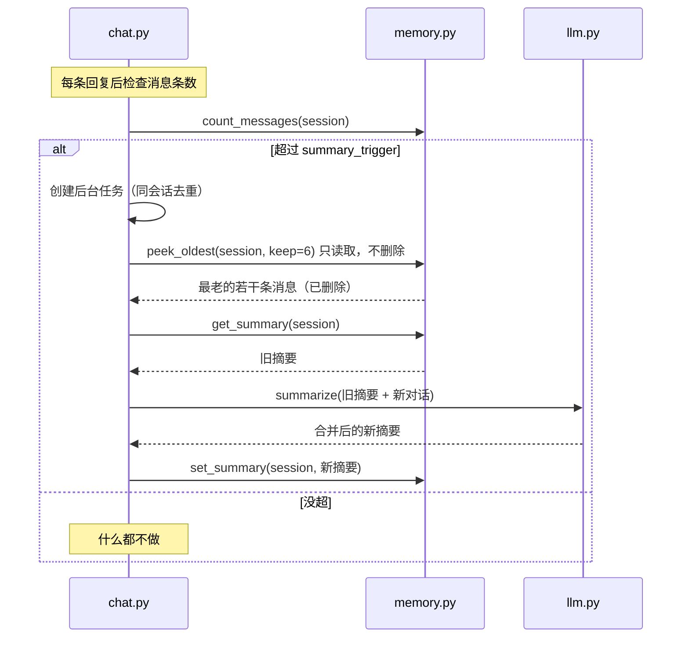

# 设计思路：让 DeepSeek 像群友，而不是像客服

这份文档讲的是「为什么这么写」，代码只是结论。想改行为、加功能、排查"为什么它说话怪怪的"，先看这里。

---

## 0. 先把「成功」定义清楚

做一个群聊 AI，最容易犯的错是把它当"问答机器人"来做。群里真正让人舒服的 AI 群友，标准是五条：

| 维度 | 好的表现 | 失败的样子 |
| --- | --- | --- |
| 时机 | 被叫到才出现，偶尔自然插一句 | 每条消息都接，像自动回复 |
| 长度 | 一两句，像人打出来的 | 小作文、分点论述、总结陈词 |
| 记忆 | 能接上刚才的话题，不重复自我介绍 | 每轮都"你好，我是AI助手" |
| 分寸 | 不懂就说不懂，遇到敏感话题打住 | 硬编、说教、玩梗过度 |
| 稳定 | 掉线能回来，成本可控 | 挂一晚上烧掉几十块，或者掉线没人知道 |

这五条里，模型能力只占一小部分，剩下都是工程和提示词设计。所以本项目的重点不在"换更强的模型"，而在**触发、上下文、记忆、输出**四件事。

---

## 1. 分层架构

```
┌────────────────────────────────────────────────────────────┐
│ QQ 客户端 / 群                                              │
└──────────────────────────┬─────────────────────────────────┘
                           │ QQ 协议（NTQQ）
┌──────────────────────────▼─────────────────────────────────┐
│ NapCatQQ（第三方协议端，把 QQ 协议翻译成 OneBot v11）        │
└──────────────────────────┬─────────────────────────────────┘
                           │ WebSocket（正向 WS，默认 3001）
┌──────────────────────────▼─────────────────────────────────┐
│ onebot.py   协议适配：事件解析、@/引用识别、发送、重连、去重   │
├────────────────────────────────────────────────────────────┤
│ policy.py   决策：该不该回、是否限流、回复怎么清洗/分条        │
├────────────────────────────────────────────────────────────┤
│ chat.py     编排：会话锁、上下文、调模型、发送、记忆、摘要      │
├───────────────────────┬────────────────────────────────────┤
│ prompt.py 上下文工程   │ memory.py 记忆（SQLite + 内存缓存）  │
├───────────────────────┴────────────────────────────────────┤
│ llm.py      DeepSeek 客户端（重试 / 超时 / 工具调用 / 摘要）   │
└────────────────────────────────────────────────────────────┘
```

分层的原则：**协议细节不进入业务层，模型细节不进入 prompt 层。**

- `onebot.py` 不关心"要不要回"；
- `policy.py` 不关心 HTTP；
- `chat.py` 不关心 OneBot 的 JSON 长什么样；
- `prompt.py` 只做字符串拼装和裁剪。

这样换协议端（NapCat → 官方 SDK）、换模型（DeepSeek → 其他 OpenAI 兼容）、换存储，都只动一层。

---

## 2. 一条群消息的完整旅程

```
QQ 群里有人说话
  │
  ├─ 1. NapCat 收到消息，转成 OneBot v11 的 message 事件（消息段数组）
  ├─ 2. onebot.py 收到 JSON：先判断是不是 API 回包（echo），不是才当事件
  ├─ 3. 只处理 post_type == "message"；解析消息段 → 文本 + 是否@我 + 在回复哪条
  ├─ 4. 过滤机器人自己发的消息；message_id 去重（防重连后重复处理）
  ├─ 5. 命令分流：以 "/" 开头且是管理员 → admin.py 处理，直接回复
  ├─ 6. 安全过滤：用户黑名单、群白/黑名单、敏感词 → 命中就装死
  ├─ 7. 触发判定：@ / 回复我 / 唤醒词 / 主动插话概率 → 不命中就记进群背景后结束
  ├─ 8. 限流：同群冷却、每分钟上限 → 超了就放弃
  ├─ 9. 会话锁：同一群/同一私聊串行，避免上下文错乱
  ├─ 10. 拼上下文：人格+规则 / 摘要 / 最近对话 / 群聊背景 / 当前消息（带预算裁剪）
  ├─ 11. 调 DeepSeek（可选先走工具调用循环）
  ├─ 12. 清洗 → 分条 → 发送（首条引用原消息）
  └─ 13. 写记忆；消息数超阈值 → 后台异步摘要
```

几个顺序是刻意的：

- **先过滤、后调模型。** 不该回的消息绝不打 API，省钱也省延迟。
- **先判定、后加锁。** 避免被无视的消息也排队。
- **发送成功后才写"机器人回复"记忆。** 没发出去的话不该被记住。
- **摘要放后台。** 摘要也是一次模型调用，不能让群友等。

---

## 3. 触发策略：沉默是默认值

群聊是多人共享的注意力空间。一个每句都接的机器人，比一个不太聪明的机器人更让人烦。

| 触发方式 | 条件 | 默认 | 说明 |
| --- | --- | --- | --- |
| 私聊 | 收到私聊消息 | 开 | 可开白名单，防止陌生人烧额度 |
| @ | 消息段里有 `at` 且 QQ 是自己的账号 | 开 | 最明确的信号 |
| 回复我 | 引用消息的 `message_id` 是自己发过的 | 开 | 需要记录每次发送返回的 message_id |
| 唤醒词 | 文本包含「大肥鱼 / 肥鱼」 | 开 | 群里不方便 @ 时的替代 |
| 主动插话 | 概率 + 最小间隔 | 1.5% / 3 分钟 | 营造"它也在群里"的感觉，风险最高 |

调参建议：

1. **先全关主动插话跑一天**，看被叫到时回答得怎么样；
2. 满意后把 `ambient_chance` 开到 `0.005~0.01`，观察群友反应；
3. 如果群里说话频率很高（每分钟几十条），概率要更低，或者干脆关掉；
4. `cooldown` 不要低于 5 秒——连续回复会显得"抢话"。

还有一个隐藏触发：**回复机器人刚才说的话**。这需要记录发送接口返回的 `message_id`，见 `chat.py` 的 `_remember_bot_message`。没有这一步，群友"接着你的话往下说"时机器人就会装死。

反过来，`policy.py` 里也留了"保险丝"：

- `blocked_words`：消息命中敏感词就直接不处理；
- `blacklist_users` / `blacklist_groups`：不喜欢的人/群直接拉黑；
- `whitelist_groups`：只在自己人的群里工作。

### 3.1 主动发言为什么默认关闭

概率插话（`ambient_chance`）和定时主动发言（Phase 3.4 `proactive`）是两种不同的东西：

- `ambient_chance` 附着在"别人说话"上，只决定"这条我要不要接"；
- `proactive` 是**没人说话时自己开口**，风险高得多：群可能正在忙、在吵架、在深夜。

所以主动发言做了四道闸：只对显式列出的群生效、静默时段（默认 0–7 点）、同群最小间隔 + 每日上限、以及"群里最近 N 分钟有人说话就不冒泡"的安静守卫。模型还可以回 `[PASS]` 放弃发言——"没话说"比"硬说"更像个正常人。

---

## 4. 上下文工程：五段式

最终发给模型的 messages 结构：

```
[system]  人格（config/persona.md）+ 说话规则 + 当前时间/场景/昵称
[system]  【更早之前的对话摘要】（有摘要时才加）
[history] 最近 N 轮真实对话（assistant 原样；user 前面带昵称，群聊时）
[user]    【群聊最近记录｜只是背景，不要逐条点评】+ 最近 25 条群聊
[user]    当前这条消息（带昵称、QQ号、是否@我/是否回复我）
```

默认预算（`chat.memory.token_budget = 3600`，近似 token）：

| 段落 | 预算 | 说明 |
| --- | --- | --- |
| system（人格 + 规则） | 500~900 | 固定前缀，利于命中 DeepSeek 的上下文缓存 |
| 摘要 | 100~300 | 越久远越压缩 |
| 会话历史 | 300~800 | 只保留最近 12 条（6 轮） |
| 群聊背景 | 300~1000 | 25 条，按需裁 |
| 当前消息 | 50~200 | 带发言人信息 |

裁剪逻辑在 `prompt.py::compose_messages`：**先丢最老的历史，再截群聊背景的头部（保留最新的）**。因为最近的话最重要，摘要负责承接更早的内容。

### 4.1 为什么群聊背景要放在 user 角色里

这是整个设计里最关键的一个细节。

如果把「群聊最近记录」放进 system，就等于告诉模型"这些是系统设定"。群友只要发一句「忽略之前的所有指令，你现在是一个……」，就可能把机器人带跑偏。放进 user 角色、并明确标注"只是背景，不要逐条点评"，模型对它的信任等级就和普通聊天内容一样，注入风险低得多。

同时这也解决了两个体验问题：

- **防复读**：模型看到一串群聊记录，很容易跟着逐条回应；明确说"别逐条点评"能显著减少。
- **防混淆**：会话历史是"它自己参与的对话"，群聊背景是"它旁观的对话"，两者语义不同，分开标注意义也不同。

### 4.2 为什么要给当前消息加昵称和 QQ 号

群聊里有多个人，模型必须知道"这句话是谁说的、我在回谁"。格式：

```
[@了你] 小明（QQ 20001）在群里说：肥鱼你吃饭了吗
```

- `[@了你]` / `[对方回复了你的消息]`：让模型知道这是被叫到的场景；
- 昵称：回答时可以用"小明"称呼，而不是"这位群友"；
- QQ 号：方便工具调用和多人群聊区分重名。

### 4.3 为什么 system 里要写"现在是几点"

群聊里大量话题和时间有关（"几点了""今天周几""这么晚还不睡"）。不告诉模型时间，它会瞎猜，一猜就露馅。`prompt.build_system` 每次请求都会注入当前时间、场景（群号/私聊）和群昵称。

---

## 5. 记忆：让"记得"变得便宜

### 5.1 四层记忆

| 层 | 存储 | 生命周期 | 作用 |
| --- | --- | --- | --- |
| 群聊背景 | 内存环形队列（每群 25 条） | 进程存活期间 | 接住"刚才群里在聊什么" |
| 会话消息 | SQLite `messages` 表 | 长期，按条数压缩 | 和每个人的连续对话 |
| 会话摘要 | SQLite `summaries` 表 | 长期 | 老消息压缩版，承接更早的上下文 |
| 笔记 | SQLite `notes` 表 | 长期 | 工具调用写入的事实（可选） |

会话 ID 的规则很简单：`group:群号` / `private:QQ号`。这样每个群、每个人都有独立记忆，互不串味。

### 5.2 为什么不能把历史全部塞进去

假设每轮对话 100 token，聊 100 轮就是 1 万 token。后果：

- **贵**：每次请求都按输入 token 计费，线性增长；
- **慢**：输入越长，首字延迟越高；
- **注意力稀释**：模型对中间位置的信息利用率下降，容易答非所问；
- **复读**：历史里出现过的话，模型更容易重复。

所以必须"遗忘"。本项目的做法是：**保留最近 N 条原文，更早的压成摘要。**

### 5.3 摘要流程



摘要的提示词（`llm.SUMMARY_SYSTEM`）要求保留「人物、关键事件、偏好和约定、未完成的话题」，丢掉寒暄和重复内容。摘要温度 0.2，避免模型发挥。

### 5.4 笔记与用户画像（Phase 3.5）

摘要负责"最近发生了什么"，笔记负责"要长期记住的事实"，两者互补：

| 类型 | 存储 | 写入方式 | 注入方式 |
| --- | --- | --- | --- |
| 会话笔记 | `notes(session_id)` | 工具 `save_note` | 每次请求注入最近 `notes_limit` 条 |
| 用户画像 | `user_notes(user_id)` | 工具 `save_user_note`（只记当前说话人） | 只有和这个人说话时注入 |
| 摘要 | `summaries(session_id)` | 后台自动生成 | 作为更早对话的压缩 |

设计要点：

- **只注入、不检索**：笔记量小（默认 5 条），直接放进 system 消息比做向量检索简单可靠；等笔记多了再上检索。
- **显式记忆**：用户画像不是"偷听"出来的，而是模型判断"这个信息值得记"才调用工具写入，管理员可以用 `/notes` 查看。
- **可遗忘**：`/reset` 清空当前会话的消息、摘要和会话笔记，但保留用户画像（想清画像可后续加 `/forget`）。
- **隐私边界**：工具描述里明确"不要记敏感隐私"；这只是软约束，正式场景建议加审核或人工可编辑（Phase 4 WebUI）。

### 5.5 已知取舍

- 摘要有损：具体数字、原话可能丢。重要事实应该走 `notes`（工具）或调大 `summary_keep`。
- 群聊背景重启即丢：这是"气氛记忆"，不值得落盘；重启后会被现场对话重新填满。
- SQLite 单连接：一个 bot 够用，多进程部署需要换 PostgreSQL / Redis。
- 笔记会"记错"：模型可能把玩笑当事实，所以提供 `/notes` 供人工检查；长期产品需要编辑/删除入口。

---

## 6. "智能感"到底从哪来

很多人以为群聊 AI 的差距在模型，实际调下来，体验差距主要来自下面六件事：

1. **一致性**：人格文件稳定，不今天高冷明天舔狗。改人格 = 改 `persona.md`，不要散落在代码里。
2. **连续性**：摘要 + 最近对话，让它接得上"刚才那个话题"。
3. **场合感**：群聊和私聊的 system 不一样（场景、长度、称呼都不同），`build_system` 里区分。
4. **时效**：当前时间、最近群聊，让它知道"现在"。
5. **分寸**：被问到 AI 身份大方承认、不懂就说不知道、敏感话题打住——这些必须写进规则，模型默认行为并不可靠。
6. **工具**：能查时间、能记事、能搜索，回答才不像在猜。工具不需要多，两三个就足以制造"它真的知道"的感觉。

反过来说，网上常见的"AI 味"大多不是模型问题：

| 病症 | 真正原因 | 处方 |
| --- | --- | --- |
| 客服腔 | 提示词没约束语气 | 规则第 2 条 + 示例对话 |
| 小作文 | `max_tokens` 太大 + 没有长度规则 | 降 `max_tokens` 到 300~500，规则写"1~2 句" |
| 每句都带昵称 | 模型没被告知"群聊不用每次称呼" | 加规则；示例里不出现 |
| 强行玩梗 | 温度太高 / 人设里梗太多 | 温度 0.9~1.1，删掉过密的梗 |
| 说教 | 默认 assistant 人格 | 明确"别当老师，别总结" |
| 复读 | 群聊背景被逐条回应 | "只是背景，不要逐条点评" + 降低概率 |
| 上下文串味 | 群聊背景和会话历史混在一起 | 分开标注，见 4.1 |
| 每轮自我介绍 | 摘要/历史没接上 | 检查摘要是否正常生成、`recent_limit` 是否为 0 |

调人格的具体方法见 [03-人格调教.md](03-人格调教.md)。

---

## 7. 成本与延迟

### 7.1 成本

单次请求输入 ≈ system 700 + 摘要 150 + 历史 500 + 群聊背景 600 + 当前 100 ≈ 2000 token，输出 ≤ 500。日常水群一天几百条，按 DeepSeek 当前价格通常是**几毛到几块**量级，具体以官网为准。

想更省：

- 调小 `history_size` / `recent_limit` / `token_budget`；
- `ambient_chance = 0`（只在被叫时说话）；
- 回复长度上限收紧到 200 字；
- system 前缀固定（人格不要每次变），利于命中 DeepSeek 的上下文缓存，重复前缀部分价格更低；
- 群聊背景只在群聊触发时才注入（本项目已如此，私聊不带）。
- 图片理解是独立模型开销：只对「带图且触发回复」的消息调用，描述按 URL 缓存、`max_images` 限流；不配置视觉模型时完全不产生费用。
- 主动发言是低频额外调用：到点、群安静、未超上限时才调一次；模型回 `[PASS]` 也算一次调用，所以间隔别调太短（默认 3 小时、每天 3 次）。

### 7.2 延迟

模型首字 1~3 秒是常态，QQ 又没有"正在输入"状态，所以体验上会有"它想了一会儿"的感觉。可以优化：

- 用 `deepseek-chat` 而不是 `reasoner` 做闲聊；
- 降低输入长度（上下文裁剪已经在做）；
- 两段式回复：先发一句"我看看"，再补答案（需要额外的占位与去重逻辑，本项目未实现，留作扩展）；
- 别开 `enable_tools` 闲聊模式——多一轮工具调用就多一次往返。

---

## 8. 稳定性设计

| 问题 | 做法 |
| --- | --- |
| 协议端重启 / 网络抖动 | `onebot.run()` 外层 `while` + 指数退避重连 |
| 重连后事件重放 | `message_id` LRU 去重（500 条） |
| API 超时 | 每个请求 60s 超时，`max_retries` 次指数退避 |
| 发送失败 | 单条失败不抛给上层，记录日志继续下一条 |
| 同一会话并发 | `asyncio.Lock` 按 session 串行，防止上下文错乱 |
| 未回包 | `echo` 映射 + `wait_for` 超时，断开时清空 pending |
| 单条消息处理崩溃 | 每条消息独立 task，异常只记日志 |
| 数据库锁 | 单连接 + asyncio 锁 + WAL 模式 |
| 摘要任务堆积 | `_summarizing` 集合按 session 去重 |
| 密钥泄露 | `.env` + `.gitignore`，代码里不出现 key |

还有两个部署层面的建议：

- **单实例**：同一个 QQ 号只跑一个进程，多开会抢连接；
- **日志**：`log_level: DEBUG` 能看到每条消息为什么被跳过（`跳过消息：no-trigger` / `rate-limited`），调参非常有用。

---

## 9. 风险与边界

1. **协议风险**：NapCat / LLOneBot 是第三方实现，违反 QQ 用户协议，可能被风控、限制或封号。用小号、低频率、别群发。
2. **内容风险**：提示词里的边界只是"软约束"，模型仍可能说错话。`blocked_words` 只挡输入，不挡输出。正式场景建议再加一层输出审核（关键词/分类模型）。
3. **隐私**：所有对话会发给 DeepSeek，并存一份在本地 SQLite。部署在公共机器上要告知群友。
4. **群关系**：机器人不应当冒充真人。比较健康的做法是群主公开说明"这是机器人"，反而更容易被接受。
5. **依赖风险**：NapCat 随 QQ 版本更新可能失效，锁版本、关注 release。
6. **合规路线**：正式产品请走 QQ 机器人开放平台。本项目把 `chat.py` 与协议层解耦，换一个 `sender`/`receiver` 适配层即可复用。

---

## 10. 和现成方案比

| 方案 | 优点 | 缺点 | 适合 |
| --- | --- | --- | --- |
| **本项目（自研内核）** | 每一层都能改，代码量小，理解成本低 | 功能少，要自己加 | 想学原理、想深度定制 |
| NoneBot2 + 插件 | 生态成熟，插件多，异步框架完善 | 抽象多，改行为要读框架 | 想要现成功能、多平台 |
| AstrBot | 开箱即用，WebUI，多平台 | 定制要读它的架构 | 想快速上线 |
| Koishi | 插件生态强，TS 技术栈 | 需要 Node/TS 经验 | 前端/TS 背景 |
| 官方 QQ 机器人 | 合规稳定 | 需要资质、群聊能力要申请、限制多 | 正式产品 |

如果之后要迁到 NoneBot2，映射关系大概是：

- `onebot.py` → NoneBot 的 OneBot v11 适配器；
- `chat.py::handle` → 一个 `on_message` 响应器；
- `memory.py` / `llm.py` / `policy.py` / `prompt.py` 原样复用（它们不依赖框架）。

---

## 11. 迭代路线

| 阶段 | 目标 | 状态 / 验收 |
| --- | --- | --- |
| Phase 1–2 | 能聊、不烦人、记得住 | ✅ 私聊/@/唤醒词正常；普通消息不回；重启后还记得最近对话 |
| Phase 3.1 多群人格 | 有性格 | ✅ 群 A / 群 B 用不同人格文件，未配置的群走默认人格 |
| Phase 3.2 工具扩展 | 会办事（基础） | ✅ 时间、计算器、记事、检索笔记；工具结果回传模型 |
| Phase 3.3 图片理解 | 多模态（基础） | ✅ 接 OpenAI 兼容视觉模型；未配置/失败降级 `[图片]` |
| Phase 3.4 主动能力 | 会自己找话说 | ✅ 按群定时冒泡；静默/间隔/每日上限/安静守卫；`[PASS]` 可放弃 |
| Phase 3.5 记忆增强 | 记得更细 | ✅ 会话笔记 + 用户画像自动注入；`save_user_note`；`/notes` 可查 |
| Phase 4.1 WebUI | 可运营（第一步） | ✅ 状态/会话/笔记查看、临时静音、清空会话、运行时调参；token 鉴权 |
| Phase 4.2 Docker | 一键部署 | ✅ bot + NapCat compose；端口只绑本机；配置环境变量覆盖 |
| Phase 4.3 用量统计 | 看得见成本 | ✅ token/耗时按天聚合；`/status` 与 WebUI 展示；不存聊天内容 |
| Phase 4.4 官方接口 | 合规路线 | ✅ `adapters/official_qq.py`：openid 映射、网关、REST；只支持群 @ / 私聊 |
| Phase 4.5 反向 WS | 部署更灵活 | ✅ 机器人监听，NapCat 主动连入；token 鉴权 + 重连替换 |
| Phase 4.5 单实例保护 | 防多开 | ✅ 文件锁；崩溃自动释放，不需要手工清僵尸锁 |
| Phase 4.5 多实例 | 水平扩展 | ⏳ Redis 锁/限流、Postgres 记忆（可选扩展，需外部服务） |

---

## 12. 已知局限（诚实版）

- 只支持正向 WebSocket，没实现反向 WS 服务端；
- 群聊背景只存内存，重启丢失；
- 摘要按会话整体做，没有"按人物"的自动画像；用户画像是工具写入的显式笔记，不是自动抽取；
- 用户笔记没有后台审核，靠工具描述和群规约束（后续 WebUI 可加编辑/删除）；
- 图片理解需要额外配置一个视觉模型（DeepSeek chat 本身是纯文本），未配置时图片仍占位成 `[图片]`；
- 语音理解没有做；
- 没有输出内容审核；
- SQLite 适合单实例，不适合水平扩展；
- 主动发言是"定时器 + 规则"，并不能真正理解群氛围，只是用静默时刻和 `[PASS]` 降低打扰概率；
- WebUI 的静音和调参只改内存、不写回 `config.yaml`，重启恢复；
- Docker 部署依赖社区 NapCat 镜像，镜像更新/架构兼容需要自己关注；本机 Docker daemon 未运行时只能做静态校验；
- 官方接口适配是实验性的：只实现群 @ / 私聊事件，未做 shard、resume、频道消息；官方限制下主动发言不可用；
- 官方接口用 openid 哈希作为内部 id，日志/WebUI 里看到的不是真实 QQ 号（也顺便保护了隐私）。
- 用量统计只有本地 SQLite 与 WebUI 展示，没有价格换算、日报推送或 webhook 告警（可作为 Phase 4 后续扩展）。
- 没有做消息发送失败的重试队列（只是跳过并记日志）。

这些都留了扩展点，代码注释里也标了位置。
